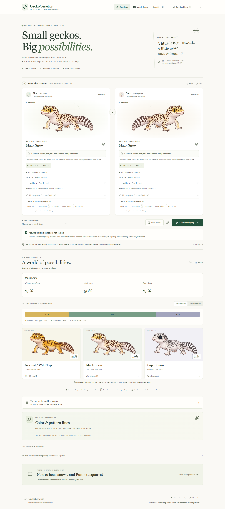

# GeckoGenetics

**A little science. A world of possibility.**

Explore what a leopard gecko pairing could produce—and understand why. GeckoGenetics brings offspring probabilities, hidden carrier genetics, and the story behind each trait into one friendly calculator.



## Meet your next discovery

- **Pair two geckos.** Choose each morph, add visible traits, then select any hidden carrier traits (hets). Combine traits freely; breeder notes and detailed settings are optional.
- **See the possibilities.** Start with Simple results: clear offspring names and plain-language carrier notes. Open Genetics details or “Why this result?” when you want the DNA notation and inheritance breakdown.
- **Understand the color story.** Keep Tangerine, Super Hypo, Carrot Tail, and other selected breeding lines separate from single-gene inheritance.
- **Learn as you go.** Browse 242 indexed morph, pattern, eye-trait, breeding-line, and marketplace names, plus 1,682 searchable Faunary label variants from listing descriptions, titles and parent fields. Filter the library by trait or source. Newer names such as Pied, Super Pied, Dark Tangerine, Pandora and KYT are searchable with their evidence status.
- **See the actual feature change.** Cartoon guides use separate body, pattern, and eye features: Eclipse changes the eyes, Pied changes white patches, stripes change the markings, and hidden carrier genes do not change the drawing.
- **Keep a pairing handy.** Save up to 20 pairings in your browser, share a pairing link, or copy results with their assumptions.
- **Choose your lighting.** Use the sun/moon button to switch between light and dark mode. Your choice stays in this browser; the first visit follows your device preference.

No accounts, subscriptions, database, or AI services. Calculations run on your device.

## Try a pairing

The calculator opens with **Mack Snow × Mack Snow**: 25% normal at the Snow locus, 50% Mack Snow, and 25% Super Snow under the stated model.

For **Black Night × Black Night het Tremper**, choose Black Night for both parents and add Tremper Albino under the second parent's **Hidden traits (hets)**. The standard estimate gives **0% visual Tremper, 50% carriers, and 50% non-carriers**, assuming the first parent does not carry Tremper. Both parents contribute Black Night ancestry; darkness and quality do not have a reliable single-gene percentage. This workflow also works for Tangerine, pattern lines, other indexed morphs, and combinations of supported genes. Select this pairing directly from the examples menu to explore it.

For **Black Night Tangerine Stripe × Black Night h MP**, select Black Night Tangerine Stripe for one parent and type Black Night h MP for the other. Choose **Use Black Night · Het Murphy Patternless** from the search; no optional settings are needed. MP means Murphy Patternless. The estimate gives **0% visual MP, 50% carriers and 50% non-carriers**, assuming the first parent does not carry MP. This pairing is also in the examples menu. You can enter other combinations directly; ambiguous codes and missing possible-het probabilities open a review instead of guessing.

Choose **Sunglow × SHTCT** from the example menu to explore the effect of Tremper carrier status:

| Dam’s documented Tremper status | Expected offspring at that locus    |
| ------------------------------- | ----------------------------------- |
| Non-carrier                     | 100% het Tremper; 0% visual Tremper |
| Confirmed het                   | 50% het Tremper; 50% visual Tremper |

The sire’s Tremper Albino strain is explicitly selected in these examples. The name “Sunglow” by itself does not establish an albino strain. Tangerine, Super Hypo, and Carrot Tail ancestry appears separately, without invented color percentages.

## Try real breeder combinations

The examples menu includes source-linked cases from [HypeGecko](https://www.hypegecko.com/shop) and [Wachi](https://wachigecko.com/):

- **Wachi WB7440:** Mack Snow Eclipse BN × Super Snow Eclipse BN.
- **Wachi WB7419:** Bandit het Tremper × Mack Snow Bandit Bold Stripe het Tremper.
- **Hype HYP95 × A43:** Mack Snow Tremper BN het Eclipse × Super Snow Tremper BN het Murphy Patternless and Eclipse; 12 genotype outcomes.
- **Wachi WB7439:** TUG Snow × TUG Snow under an explicitly stated one-copy dominant scenario.

The [full marketplace audit](docs/MARKETPLACE_AUDIT.md) covers 223 product pages, 186 leopard geckos, all 110 recorded leopard-gecko parent pairs, and 5,760 male × female listing scenarios. An omitted probability, uncertain phenotype, trade name, or albino-line field is not converted into a confirmed gene. Other-species and non-animal listings are identified separately.

The [Faunary description audit](docs/FAUNARY_AUDIT.md) reads all **1,398 full public descriptions** in the 9 November snapshot, including sales and auctions. It records morph, sire, dam and albino-line fields and links every listing. Faunary combinations appear in the parent search; wrong-category other-species records and bundles are identified separately. A source label is a naming example, not proof of your animal’s pedigree.

## Good genetics starts with good records

Percentages describe the chance for **each egg**, not a guaranteed clutch. Predictions depend on entered genotypes and the assumptions shown with the results.

Your color and pattern lines stay visible on every offspring card. For **Black Night × Mack Snow Eclipse Black Night**, the standard estimate gives **50% with Mack Snow and 50% without it; all carry Eclipse**, assuming the first parent has neither Snow nor a hidden Eclipse copy. Both groups keep their **Black Night line** background. Lighter and darker drawings are examples, not a prediction of how many babies will be dark. The same family-line display works for Tangerine, Bold Stripe and other selected lines, including pairings with no percentage-based traits.

A normal appearance cannot rule out hidden recessive alleles. The default **Assume unlisted genes are not carried** option enables standard pairing estimates without requiring detailed records for both parents. Every assumption used in an active gene calculation is shown beside the results. Turn it off to calculate from entered records only. An explicitly unknown entry always stays unknown; assumptions never rewrite parental records and are included in saved/shared pairings. Older links without this option retain their record-only behavior.

“66.67% possible het” means a two-thirds chance of being a carrier under the stated parentage; it does not mean two-thirds of an allele. The calculator distinguishes an exact 2/3 from a literal 66% estimate.

The library includes breeding lines, combination names, and disputed traits beyond the supported calculation model. Its index draws on breeder references and marketplace listings; a marketplace label is evidence of naming, not proof of a new gene. No finite search can establish every trade name, and this index does not infer an animal’s genotype from its photograph. Pied/Super Pied are pattern descriptions with no invented expression percentages. Bojoneroko is indexed as an unverified trade line because primary originator genetics documentation was not located. Compact names such as `SSEBN`, dotted `h.` / `ph.` qualifiers, and confirmed combination hets are expanded for review. Single-letter `T` / `R` and ambiguous Snow codes require an interpretation. Missing possible-het probabilities stay unknown; a compound possible het does not create independent carrier probabilities unless you explicitly choose that scenario.

Lemon Frost and Enigma trigger welfare information and withheld predictions, including recognized Enigma combination names. No offspring sex, survival, fertility, health, or inbreeding coefficient is predicted. See the [evidence and source limitations](docs/GENETICS_REFERENCES.md) and [calculation assumptions](docs/ASSUMPTIONS.md).

## Privacy & sharing

Saved pairings live in this browser’s local storage. Clearing browser data removes them; they do not sync between devices. A share link includes the entered pairing, evidence notes, and observed hatchling label. Review those details before sharing. Links are validated when opened. Observations never rewrite parental alleles.

## Run it yourself

On Windows, after building once, double-click **Start-GeckoGenetics.cmd** to start the local website and open your browser. The launcher reuses a running GeckoGenetics preview, starts one if needed, and chooses another local port if a different app is using the usual address. It runs independently of a terminal or Codex chat. After restarting your computer, double-click it again. The printed address works on that computer while its local server runs.

The local ZIP download includes the production website and launcher; it needs Node.js but does not need a dependency install. Extract the ZIP before opening the launcher.

Install [Node.js 24 LTS](https://nodejs.org/) and [pnpm](https://pnpm.io/installation), then:

```sh
git clone https://github.com/0xAldoLim/geckogenetics.git
cd geckogenetics
pnpm install
pnpm dev
```

Open the local address printed in your terminal.

```sh
pnpm test                         # Genetics and data validation
pnpm exec playwright install chromium
pnpm test:e2e                     # Desktop and mobile browser tests
pnpm build                       # Production website in dist/
pnpm preview                     # Preview the production build
node scripts/start-preview.mjs   # Start/reuse the local website in the background
```

Deploy `dist/` to any static host. Relative asset paths support a repository subdirectory; pairing links use a URL fragment, so no application server is required. GitHub Actions runs the checks and uploads a production build for each push.

## For contributors

Built with React, strict TypeScript, Vite, Tailwind CSS, Vitest, and Playwright. Genetics rules and catalog data live independently of the interface. Exact rational arithmetic preserves probabilities until display.

- [Architecture](docs/ARCHITECTURE.md)
- [Genetics catalog, evidence, and references](docs/GENETICS_REFERENCES.md)
- [Assumptions and limitations](docs/ASSUMPTIONS.md)
- [Illustration and dependency attribution](docs/ATTRIBUTION.md)
- [Cartoon artwork prompts and feature mapping](docs/ARTWORK.md)

Found a missing morph or a genetics correction? [Open an issue](https://github.com/0xAldoLim/geckogenetics/issues) with the name, original breeder records or research, and any relevant welfare evidence. New catalog entries do not automatically become independent modeled genes.
